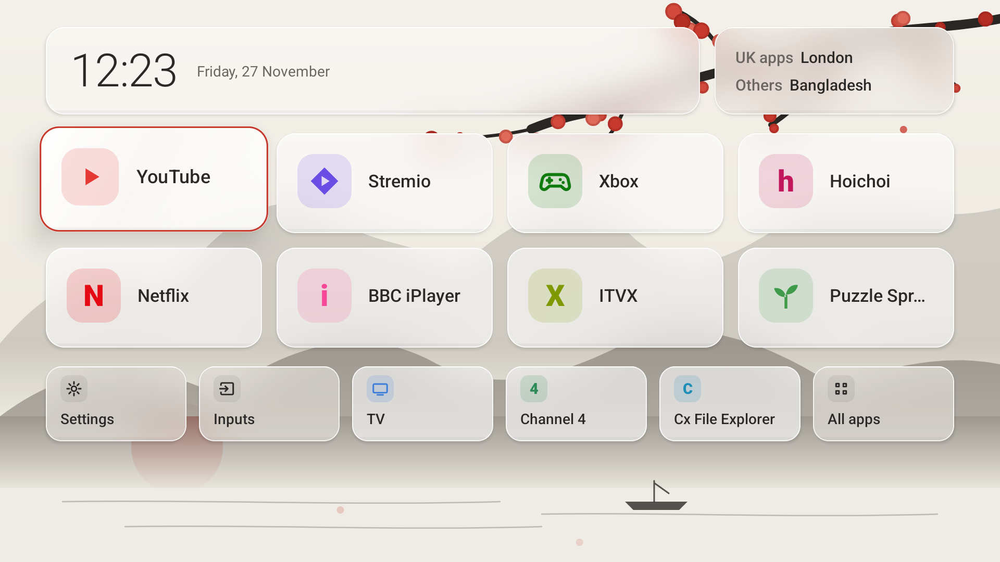
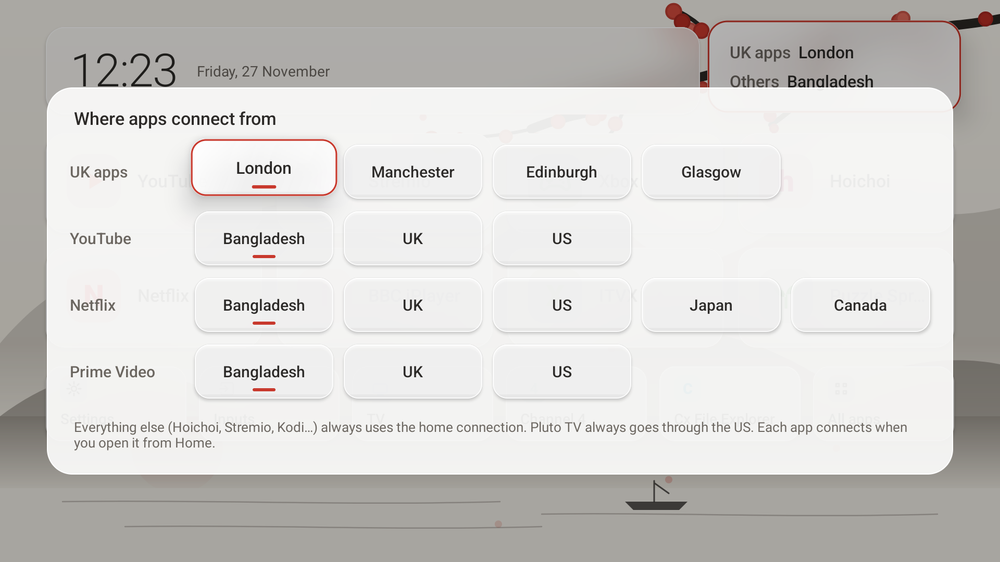
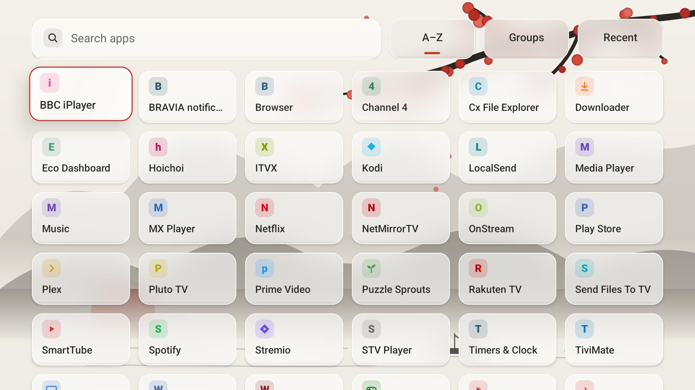
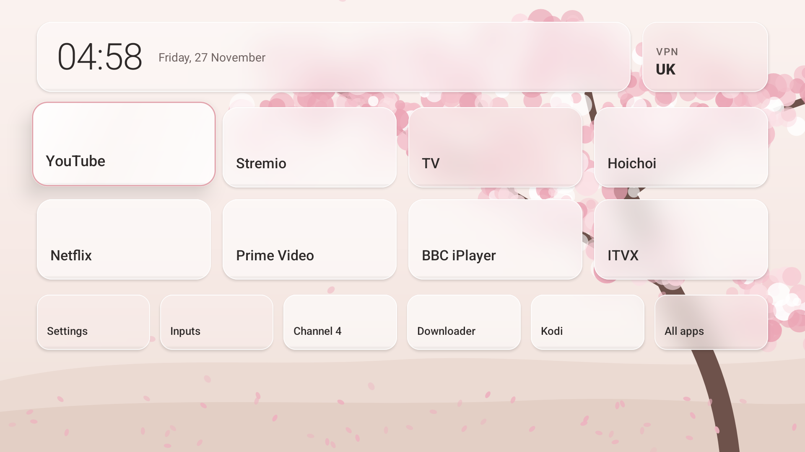
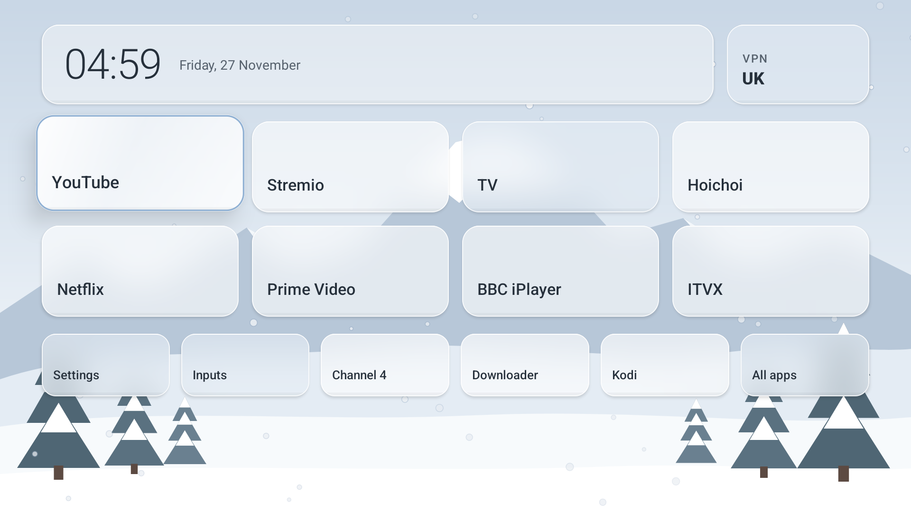

# BRAVIA Launcher

A small, fast, home-made home screen for a Sony BRAVIA Google TV, built to replace the stock
Google TV home and third-party launchers on a TV that is short on memory.



The stock home kept the TV busy with recommendation rows, account sync and background
services, and lost our app order. This launcher is one screen of big glass keys over a painted
seasonal scene. It needs no account, no server and no root, and runs nothing in the
background. It is built for one TV (Sony KD-65X80J: Android 12, 32-bit, 3 GB RAM) but should
run on any Android TV 8.0+.

## Features

- **Favourites:** eight large keys in your own order, with a bottom row for Settings, Inputs,
  live TV, recent apps and All apps. Everything is D-pad driven, with an Apple TV-style focus
  (the key grows, lifts and catches a sheen).
- **Seasonal scenes:** Ume (ink-wash mountains, red sun, plum branch), Sakura (cherry
  blossom) and Yuki (snow), chosen by month. Petals and snow drift at about 30 fps and freeze
  after 10 minutes without a key press.
- **Our own icon set:** each app gets a generic symbol in its brand colour, readable from the
  sofa and by kids. Unknown apps get a letter in the dominant colour of their real icon.
- **All apps:** search with the TV keyboard; sort A–Z, by group (Watch, Streamers, Players,
  Music, Games, …) or by recent use.
- **Editing on the TV:** hold OK (or press Menu) on a key to move, add, remove, hide or regroup it.
  The layout is saved atomically (the TV is prone to hard reboots) and never synced.
- **Xbox key:** opens the console's HDMI input and wakes the Xbox, over HDMI-CEC or with the
  Xbox app's network power-on packet (the console's Live ID is learnt automatically).
- **VPN by app group:** with the [WireGuard](https://www.wireguard.com/) app as the TV's
  always-on VPN, choose a location per group (UK apps, YouTube, Netflix, Prime Video, Max,
  Disney+). The launcher switches to the right tunnel when you open an app and restores the
  resting one when you come back Home. Everything else uses the normal connection.
- **Storage aware:** flags favourites that an update moved onto the adopted USB drive and
  offers to move them back.
- **Light:** about 25 MB PSS on Home, a ~190 KB APK, pure Kotlin with plain Views (no Compose,
  no Leanback, no native code). Cold start is about 0.3 s.

| VPN panel | All apps |
| --- | --- |
|  |  |

| Sakura (earlier build, before icons) | Yuki (earlier build, before icons) |
| --- | --- |
|  |  |

## Build and install

Needs JDK 17, the Android SDK and network adb on the TV (Developer options → USB/ADB
debugging, then `adb tcpip 5555` or the TV's network debugging switch).

```bash
./gradlew assembleRelease               # release signing: see app/build.gradle.kts (keystore.properties)
adb connect <tv-ip>:5555
TV=<tv-ip>:5555 scripts/install.sh      # install, keep on internal storage, sync
adb shell cmd package set-home-activity io.github.shhrrtnvr.bravialauncher/.HomeActivity
```

`install.sh` moves the app back to internal storage when the TV's "Force allow apps on
external" option put it on an adopted USB drive. A home screen there would start late at
boot.

To go back to the stock home:

```bash
adb shell pm enable com.google.android.apps.tv.launcherx
adb shell cmd package set-home-activity com.google.android.apps.tv.launcherx/com.google.android.apps.tv.launcherx.home.HomeActivity
```

## VPN setup (optional)

1. Install WireGuard and turn on **Settings → Allow remote control apps**.
2. Grant the launcher control:
   `adb shell pm grant io.github.shhrrtnvr.bravialauncher com.wireguard.android.permission.CONTROL_TUNNELS`
3. Edit `app/src/main/assets/vpn-routes.json` (groups, apps, locations and tunnels).
4. Put your WireGuard private key in `~/.config/bravia-vpn/private.key` and your provider's
   servers in `~/.config/bravia-vpn/servers.json` (format: `scripts/servers.example.json`).
5. Run `scripts/vpn-configs.py` and import the generated `.conf` files into WireGuard on the TV.
   Then delete the copies you pushed, because they contain the private key.

The launcher never runs a VPN itself: it only asks WireGuard to switch tunnels.

## Project layout

| Path | What |
| --- | --- |
| `app/src/main/java/…/HomeActivity.kt` | Home screen, focus rules, VPN key and panel |
| `Scenes.kt`, `Glass.kt`, `Particles.kt`, `Themes.kt` | Painted scenes, frosted-glass keys, petals and snow |
| `Apps.kt`, `AppIcons.kt`, `AppGroups.kt`, `AllAppsGrid.kt` | App list, icon set, groups, All apps page |
| `LayoutStore.kt`, `Storage.kt` | Saved layout (atomic, device-protected storage) |
| `VpnRoutes.kt`, `VpnSwitch.kt` | Per-group routing and WireGuard remote control |
| `XboxWake.kt` | Xbox network power-on and discovery |
| `design/` | Mockups from each design round, and screenshots |
| `docs/plan.md` | Full build log: decisions, measurements, TV quirks and what was disabled |

## Notes

- Built for personal use on one TV; package names in the defaults (favourites, groups, VPN
  routes) match that TV's apps.
- App icons are our own generic shapes, not the services' logos. All trademarks belong to
  their owners.
